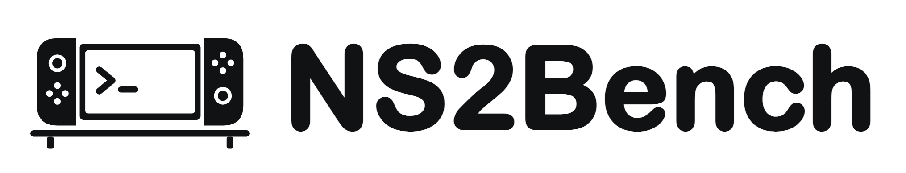
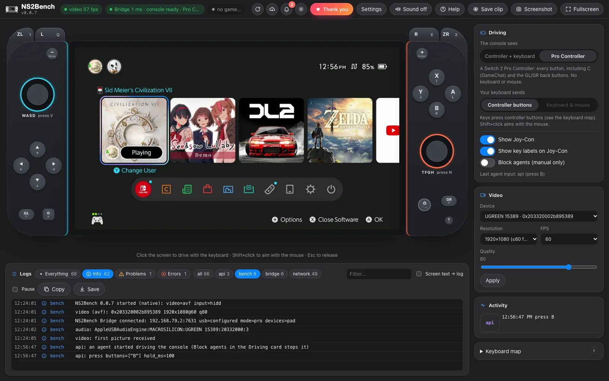
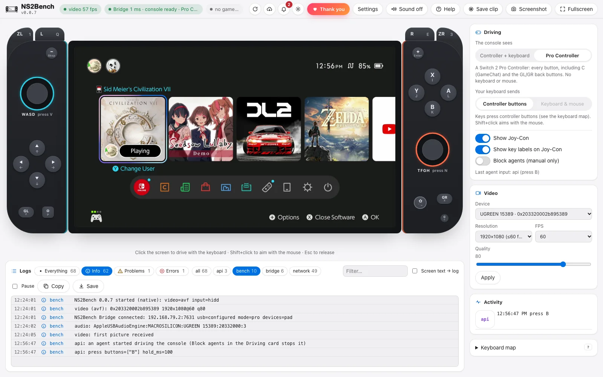
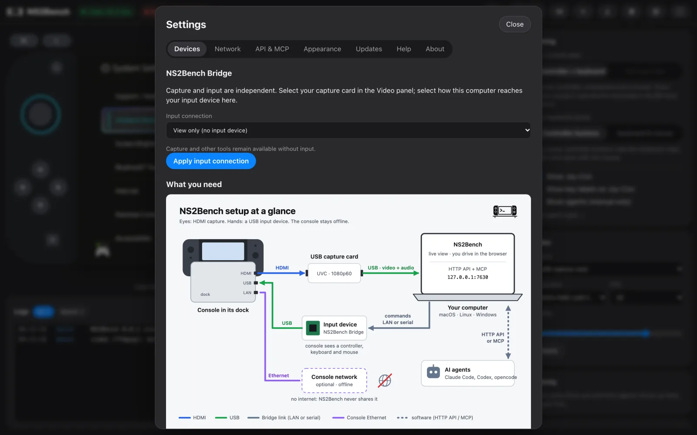
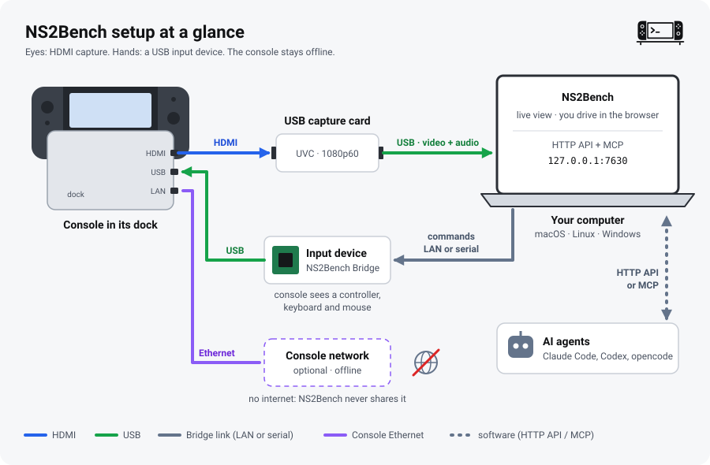

# NS2Bench

<p align="center">
  <picture>
    <source media="(prefers-color-scheme: dark)" srcset="branding/png/lockup-horizontal-white.png" />
    
  </picture>
</p>

<p align="center">
  <a href="https://github.com/phantomptr/ns2bench/releases"></a>
  <a href="LICENSE"></a>
  
  
  <a href="https://discord.gg/fzK3xddtrM"></a>
</p>

<p align="center"><b>See, hear and drive a Nintendo Switch 2 from your computer, by hand or by AI agents. The console stays offline.</b></p>

<p align="center"><a href="https://ns2bench.phantomptr.com/">Website</a> · <a href="https://github.com/phantomptr/ns2bench/releases/latest">Download</a> · <a href="docs/setup/README.md">Setup guide</a> · <a href="FAQ.md">FAQ</a></p>

---

## What it does

- **See and hear the console:** live 1080p60 video and sound from any USB HDMI capture card. Screenshots, 30-second clips, and reading on-screen text (OCR).
- **Drive it:** keyboard, mouse or your own gamepad, sent through a small input device on the console's USB port. On-screen Joy-Con light up with every press.
- **Let agents drive it:** an HTTP API and an MCP server (Claude Code, Codex, opencode and others). You watch every agent action live, and one switch blocks agent input.
- **Test it:** repeatable JSON tests with screenshots, a clip of the moments before any failure, navigation routes and a doctor that says which part is broken.
- **Know what's going on:** logs with levels, and for known problems what happened and what to do. Desktop notifications when the Bridge or the picture drops, a test finishes or an update is ready. **Help → Run the check** tests every part.
- **Set up the rest from the app:** **Settings → Install** puts the `ns2bench` command on your PATH, flashes a Pico, installs the Bridge on a Linux board over SSH, and runs the offline network helper as a service.
- **Keep it offline:** an optional console network with local DHCP and a DNS that answers only the connectivity test. No forwarding, no NAT, no internet.

## What it doesn't do

- It doesn't modify the console, install anything on it, or need homebrew.
- It never gives the console internet access or talks to Nintendo's servers.
- It doesn't bypass any protection. It sees what a TV sees and presses what a controller presses.

## A quick look







## How it connects



You need a **capture card** for video and sound, and one **input device** to press buttons:

| You have | Use | Controller buttons | Keyboard and mouse |
|---|---|---|---|
| A Linux board with a USB device port (Luckfox Pico, Raspberry Pi Zero 2 W, Pi 4/5) | [Network Bridge](docs/setup/README.md) | all (Pro Controller mode adds C, GL, GR) | yes |
| A Raspberry Pi Pico and a 3.3 V USB-to-UART adapter | [Serial Bridge](docs/setup/README.md) | all except C, GL, GR | yes |
| A CH9329 module | [CH9329](docs/setup/README.md) | no | yes |
| Only a capture card | [View only](docs/setup/README.md) | no | no |

The **[setup guide](docs/setup/README.md)** has a diagram, a parts list and step-by-step instructions for each of these, plus the optional offline console network.

## Install

Download the app for your computer from the **[latest release](https://github.com/phantomptr/ns2bench/releases/latest)**:

| Computer | File |
|---|---|
| Mac with Apple silicon | `NS2Bench-<version>-mac-arm64.dmg` |
| Mac with Intel | `NS2Bench-<version>-mac-x64.dmg` |
| Windows | `NS2Bench-<version>-win-x64-setup.exe` (or `win-arm64` for Snapdragon/ARM PCs) |
| Linux | `NS2Bench-<version>-linux-x64.AppImage` or `.deb` (also `arm64`) |

For the input device: `ns2bench-board-*` (Linux boards, installed with `board/install.sh`) or `ns2bench-pico-*.uf2` (Raspberry Pi Pico). Every file is listed in `SHA256SUMS`, and the app checks the checksum of every update it installs.

### First-launch warnings (and why they're there)

NS2Bench isn't signed with paid Apple or Microsoft certificates yet. Gatekeeper (macOS) and SmartScreen (Windows) treat unsigned downloads as suspicious until you allow them once.

**macOS**: "NS2Bench is damaged and can't be opened" or "cannot be opened because Apple cannot check it":

```bash
xattr -dr com.apple.quarantine /Applications/NS2Bench.app
```

That removes the *quarantine* flag macOS puts on everything downloaded from a browser. Or: right-click NS2Bench in Applications → **Open** → **Open**, or System Settings → Privacy & Security → **Open Anyway**. Either way, once per install. Then allow **Camera** (the capture card's picture), **Microphone** (console sound) and **Local Network** (the input device) when asked.

**Windows**: "Windows protected your PC":
- Click **More info** → **Run anyway**. It's shown only until SmartScreen trusts the file.
- If a policy blocks "Run anyway": right-click the installer → **Properties** → tick **Unblock** → **OK**.

**Linux**: no warning. `chmod +x NS2Bench-*.AppImage` and run it, or install the `.deb`.

### System requirements

| | Needs | Install first |
|---|---|---|
| macOS 14+ | nothing else | (optional, for clips) `brew install ffmpeg` |
| Windows 10/11 x64 or arm64 | ffmpeg | `winget install Gyan.FFmpeg`; a USB-UART driver (CH340/CP210x) for serial devices |
| Linux x64/arm64 | ffmpeg, `video`/`dialout` groups | the `.deb` pulls in ffmpeg; `sudo usermod -aG video,dialout $USER` |

Details for each system are in the setup guide's **[Before you start](docs/setup/README.md#before-you-start-your-computer)**. If ffmpeg is missing, NS2Bench says so and shows the command for your system.

## Quick start

1. Connect the console, capture card and input device as shown in the [setup guide](docs/setup/README.md).
2. Open NS2Bench. In the **Video** panel pick your capture card.
3. Open **Settings → Devices**, choose your input device and **Apply**. The **Bridge** pill in the top bar turns green when the console sees the controller.
4. Click the video and drive with the keyboard, or plug in a gamepad. If something isn't right, click **Help** in the top bar and **Run the check**: it says which part is broken and how to fix it.

To let an AI agent drive, open **Settings → API & MCP** and copy the MCP configuration into your agent, or:

```sh
claude mcp add ns2bench -- /Applications/NS2Bench.app/Contents/MacOS/ns2bench-app mcp
```

## Build from source

```sh
cp examples/bench.example.json bench.json      # your capture device and input device (never committed)
make serve                                     # engine + UI at http://127.0.0.1:7630
make app                                       # desktop app (needs: cargo install tauri-cli --version '^2')
make test                                      # every Rust test
```

`make` lists every task, including `board`, `board-install BOARD=<ssh-host>`, `pico` and `netd`. You need Rust (stable); Xcode command line tools on macOS (the capture helper is Swift); `ffmpeg` on Linux and Windows.

## Architecture

```text
console HDMI ──> USB capture card ──> computer ── NS2Bench engine ──> UI (you, browser or desktop app)
console USB  <── input device (NS2Bench Bridge) <── network or serial ──┘   └─> HTTP API / MCP (agents)
```

- **Engine** (`native/crates/core`, Rust): capture, input hub, OCR, tests, recorder, HTTP/WebSocket API and MCP.
- **Desktop app** (`native/crates/app`, Tauri 2): the engine and the web UI (`web/`) in one window, with verified updates.
- **NS2Bench Bridge**: `ns2bench-board` (`native/crates/board`), one static Rust binary for Linux USB-gadget boards, or the Pico firmware (`firmware/pico`, embassy).
- **Offline network** (`native/crates/netd`): DHCP, local-only DNS and the connectivity test on one interface.

More detail, the full HTTP API and the test format are in **[docs/REFERENCE.md](docs/REFERENCE.md)**.

## Supported platforms

| | macOS | Windows | Linux |
|---|---|---|---|
| Desktop app | ✅ arm64, x64 | ✅ x64, arm64 | ✅ x64, arm64 |
| Capture | ✅ native, shares the card with OBS | ffmpeg (DirectShow) | ffmpeg (V4L2) |
| Offline console network | ✅ | via a Linux helper or a router | ✅ |

Tested on hardware so far: macOS capture (UGREEN 15389) and a Luckfox Pico Max board in both controller modes. The Pico firmware, a real CH9329 module and Windows/Linux capture are built and tested in software, not yet on hardware. [Hardware reports](https://github.com/phantomptr/ns2bench/issues/new/choose) are very welcome.

## API and AI agents

The engine listens on `127.0.0.1:7630`. The MCP server (34 tools: see, find text, wait for the screen, drive, navigate, test, check health, debug) is the same binary run with `mcp`; it talks to the running engine, so you see everything an agent does. Examples for Claude Code, Codex and opencode, and every HTTP endpoint, are in [docs/REFERENCE.md](docs/REFERENCE.md#agents-mcp-and-http-api).

## Command line

`ns2bench` does everything the API and MCP do, from a terminal or a script. It talks to the running app (or `ns2bench serve`), so you see every action in the window.

```sh
ns2bench health                              # ready to drive? if not, what to fix
ns2bench status                              # video, Bridge, console USB, agents
ns2bench press A --hold-ms 120               # also: hold, release, stick, key, type, mouse, click
ns2bench navigate system_settings            # go somewhere and verify it
ns2bench read --region 0,0,0.5,0.2           # on-screen text
ns2bench find "System Settings"              # where a text is on screen
ns2bench press A && ns2bench wait-screen     # wait for the screen to react (or --stable)
ns2bench wait-text "Airplane Mode" --timeout 10
ns2bench test examples/tests/settings-smoke.json
ns2bench clip --seconds 20                   # also: screenshot, bundle, diagnostics
ns2bench logs --follow --level warn          # problems only; also: events, doctor --probe
ns2bench input --backend serial --serial-port /dev/ttyACM0 --baud 921600
```

Add `--json` for raw output, `--url` / `--token` (or `NS2BENCH_URL` / `NS2BENCH_TOKEN`) for another engine. `ns2bench --help` lists every command. It ships inside the app: **Settings → Install → Install command line tool** puts it on your PATH. It's also in each release (`ns2bench-cli-<version>-<os>-<arch>`), or build it with `make build`. The desktop app itself also runs `ns2bench-app mcp` (the MCP server) and `ns2bench-app update check|install` (update from a terminal).

## FAQ

Common questions (setup, capture cards, input devices, the offline network, agents, troubleshooting) are answered in **[FAQ.md](FAQ.md)** and on the [website](https://ns2bench.phantomptr.com/faq/).

## Roadmap

What's next (waking from sleep, a test recorder, visual checks, more input devices, multi-console) is in [ROADMAP.md](ROADMAP.md).

## Contributing

Bug reports, hardware reports, translations and code are welcome. See [CONTRIBUTING.md](CONTRIBUTING.md). Security issues: [SECURITY.md](SECURITY.md).

## Reporting bugs

In the app, click **Help** in the top bar and choose **Save bug report**. It saves a zip with logs, status and a screenshot (tokens are removed) that you can attach to a [GitHub issue](https://github.com/phantomptr/ns2bench/issues/new/choose). **Open an issue on GitHub** fills in your version and OS for you.

## How this project is built

NS2Bench is written with the help of AI coding tools, and reviewed and tested by a person on real hardware. Every release lists what was and wasn't tested on hardware.

## Disclaimer

NS2Bench is an independent project. It is not affiliated with, endorsed by or sponsored by Nintendo. Nintendo Switch is a trademark of Nintendo. Use it with hardware you own, keep the console offline, and follow the terms that apply to your console and software. It is provided as is, without warranty (see [LICENSE](LICENSE)).

## Credits

NS2Bench builds on others' work. **Included** means code or data in this repo derived from the project; **library** means a dependency used at build time; **reference** means documentation we learned from.

**Included:**
* [GP2040-CE](https://github.com/OpenStickCommunity/GP2040-CE) (OpenStickCommunity) — the Switch 2 Pro Controller descriptors, command replies and flash tables in [native/crates/board/src/pro2.rs](native/crates/board/src/pro2.rs). MIT.

**Libraries:**
* [Tauri](https://tauri.app/) — the desktop app.
* [Tokio](https://tokio.rs/) and [axum](https://github.com/tokio-rs/axum) — the engine's runtime and HTTP/WebSocket server.
* [embassy](https://embassy.dev/) (`embassy-rp`, `embassy-usb`) — the Raspberry Pi Pico firmware.
* [image](https://github.com/image-rs/image), [serde](https://serde.rs/), [reqwest](https://github.com/seanmonstar/reqwest) and the other crates listed in `native/Cargo.lock`.

**Used at runtime (not bundled):**
* [FFmpeg](https://ffmpeg.org/) — capture on Windows and Linux, and clips.
* [Tesseract](https://github.com/tesseract-ocr/tesseract) — optional OCR where Apple Vision isn't available.

**References:**
* [ndeadly/switch2_controller_research](https://github.com/ndeadly/switch2_controller_research) — Switch 2 controller protocol notes.

License texts for included code are in [`LICENSES/`](LICENSES/).

## Thanks

Thanks to the console research and homebrew communities whose open documentation makes projects like this possible.

## License

GNU General Public License v3.0 or later (GPL-3.0-or-later). See [LICENSE](LICENSE).

Under GPLv3 section 7, [NOTICE](NOTICE) adds terms for every copy and modified version: keep the attribution **"NS2Bench, created by PhantomPtr"** in the app's About screen and in the documentation, mark modified versions as modified, and don't use the NS2Bench name or logo for them. Derived GP2040-CE material stays under its MIT license ([`LICENSES/`](LICENSES/)). Each release also includes `THIRD-PARTY-LICENSES.txt` with the license and notice texts of every open-source package compiled into the binaries (`node scripts/third-party.mjs` builds it).

## Author

Created and maintained by **PhantomPtr**.

* [Follow me on X (@phantomptr)](https://x.com/phantomptr)

## Support

If NS2Bench is useful to you, you can support its development:

* Join the [Discord](https://discord.gg/fzK3xddtrM) for help and news.
* [](https://ko-fi.com/B0B81S0WUA)
* Crypto: see the addresses below.

| Coin | Network | Address |
| --- | --- | --- |
| BTC | Bitcoin | `bc1q36gxkvd3wfxy9azm8hft3rru9m6m9hjvn7u20n` |
| ETH | Ethereum | `0x2e787654db543B69FB011E16995C274dFAfc2286` |
| SOL | Solana | `G1q5XCCn3mePYpcx7uY17CwDsUaAZTcty56huUDvVqjG` |
| XRP | XRP Ledger | `rEVq3si3sm9NuWNuZiUZFKsUtwC3w9SrjR` (no destination tag needed) |

QR codes for each are on [the website](https://ns2bench.phantomptr.com/#thanks).

### Thank you

Thank you to everyone who supports the project.
