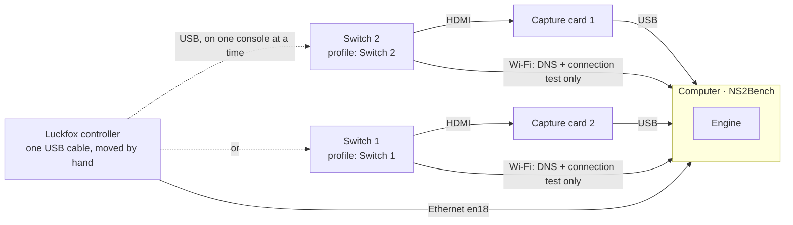
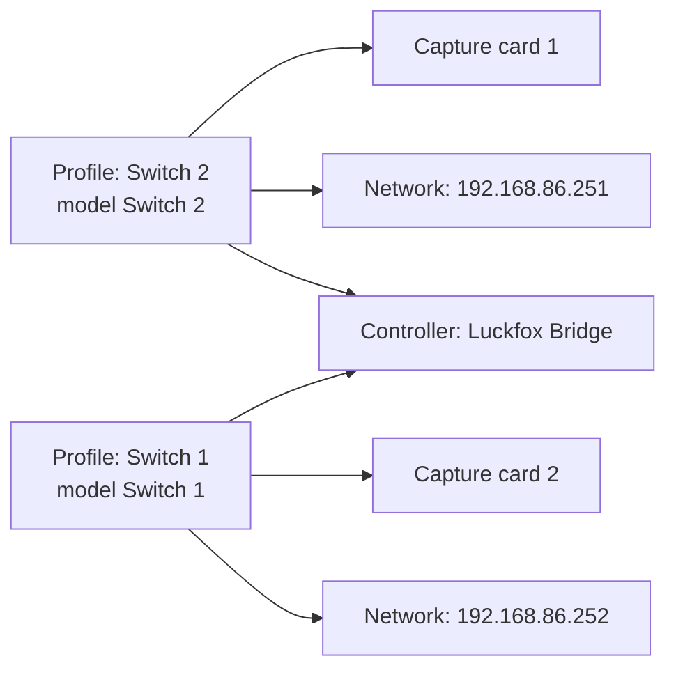
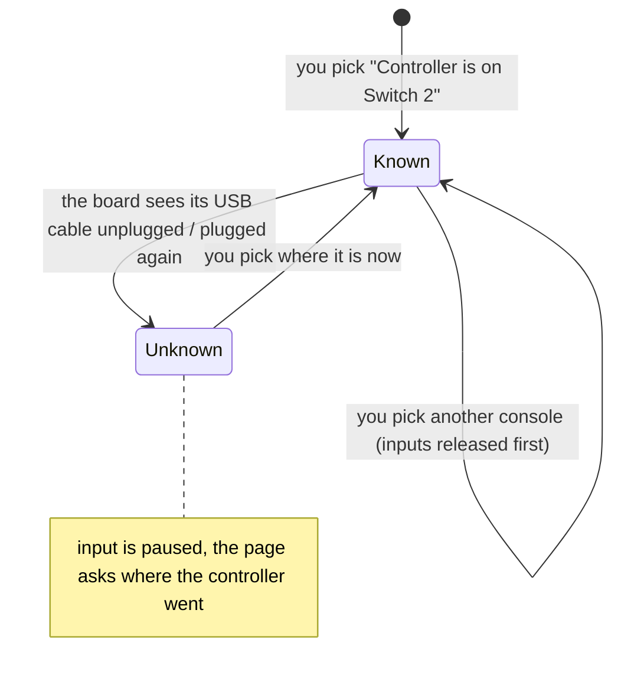

# Design: several consoles on one bench

Status: in progress (0.0.17). Builds on [shared-network.md](shared-network.md).

## The bench this is for



Each console has its own picture and sound (its own capture card) and its own network
address. They share one controller: the Luckfox, whose USB cable you move between them.

## A console profile

Each console has a **profile**: everything that console uses, in one place.

| Part | What it is | Examples |
|---|---|---|
| Name | Yours to choose | "Switch 2", "Switch 1 OLED", "Test unit B" |
| Model | Sets menu routes, screen names and the controller mode | Switch 2, Switch 1 |
| Capture card | Picture and sound | UGREEN 15389, Elgato 4K60 Pro |
| Network | How the console reaches this computer | Shared home network at 192.168.86.251, a direct cable, or none |
| Controller | Which input device drives it | Luckfox Bridge at 192.168.79.2, a Pico on a serial port, a CH9329, or none (view only) |

**Capture cards and controllers are lists of their own**, and a console profile points at one of
each. Two profiles can point at the same one: today your two Switches share the Luckfox (you move
its USB cable), and a capture card can be shared the same way (you move the HDMI cable, or use an
HDMI switch). Only a shared device needs the "which console is it on?" tracking below; a console
with devices of its own never asks.

**Names used everywhere** (app, docs, API):

| Name | What it is |
|---|---|
| **Console** | One Switch, with its profile |
| **Capture card** | HDMI-to-USB card that gives the picture and sound |
| **Controller** | The device that presses buttons on the console: a Luckfox or Raspberry Pi board, a Pico, or a CH9329. The NS2Bench software on a board or Pico is the **NS2Bench Bridge** |
| **Network** | How the console reaches this computer: shared home network, direct cable, or none |



## Goals

- **A profile per console:** a name you choose, its model (Switch 2 or Switch 1), its capture card,
  its network and its controller.
- **Both pictures live at once.** Watch either one big with the other small; screenshots,
  clips, OCR and tests work on any console.
- **Input only ever reaches the console the controller is plugged into.** NS2Bench never guesses.
- Agents (API, MCP) name the console they mean; old single-console calls keep working.
- One console stays exactly as simple as today: nothing new to set up.

## The controller: where is it?

A USB controller is plugged into one console at a time, and only you know which, so NS2Bench
keeps a **controller location**: a console, or *unknown*.



- **Input is sent only when the location is known**, and only to that console. A press aimed at
  another console is refused with a clear message (the controller can't reach it).
- **A shared capture card works the same way:** NS2Bench keeps which console it shows. When its
  picture drops and comes back (the HDMI cable moved, or an HDMI switch flipped), it asks which
  console it shows now; until you answer, screenshots, clips and screen reading on it are paused
  so nothing is saved under the wrong console.
- **Moving the cable is noticed:** the board reports its USB link (attached / not attached).
  Unplugged, then attached again: the location becomes *unknown*, inputs are released and the
  page asks "Which console is the controller on now?". A single console needs no question.
- **Changing the location** releases every held input first, then switches the board's USB mode
  to the console's preferred one (Switch 2: Pro Controller; Switch 1: standard controller),
  if they differ.

## Models

| Model | Controller mode | Menu routes and screens | Notes |
|---|---|---|---|
| Switch 2 | Pro Controller (all buttons incl. C, GL, GR) | `profiles/switch2.json` (verified) | as today |
| Switch 1 | Standard (HORI) controller | `profiles/switch1.json` (starts minimal) | Switch 2 Pro protocol not used |

A model is data: adding one later is a new file, not new code.

## What belongs to a console

| Setting | Per console | Shared |
|---|---|---|
| Name, model, colour | ✓ | |
| Which controller (input device) | ✓ (a reference) | the device itself can be shared |
| Capture card, size, frame rate, quality, sound device | ✓ | |
| Live view, screenshots, clips, OCR, screen log | ✓ | |
| Network address (shared home network, leak watch) | ✓ | |
| Power / wake settings | ✓ | |
| Press calibration (shortest reliable press) | ✓ | |
| Controller devices and their connections (Luckfox, Pico, CH9329) | | ✓ (a list) |
| Block agents, logs, notifications, appearance | | ✓ |

Stored in `~/.ns2bench/consoles.json`:

```json
{
  "consoles": [
    { "id": "switch-2", "name": "Switch 2", "model": "switch2", "color": "#e60012",
      "capture": { "device": "0x2033…", "width": 1920, "height": 1080, "fps": 60, "quality": 80 },
      "network": { "mode": "shared", "address": "192.168.86.251" },
      "controller": "luckfox" },
    { "id": "switch-1", "name": "Switch 1", "model": "switch1", "color": "#0ab9e6",
      "capture": { "device": "0x1a2b…" },
      "network": { "mode": "shared", "address": "192.168.86.252" },
      "controller": "luckfox" }
  ],
  "controllers": [
    { "id": "luckfox", "name": "Luckfox Bridge", "backend": "hidd", "host": "192.168.79.2", "port": 7631,
      "token_file": "~/.ns2bench/hidd.token" }
  ],
  "controller_on": { "luckfox": "switch-2" }
}
```

**Upgrade path:** with no `consoles.json`, today's `video.json` and `input.json` become one
console, "Switch 2" (model Switch 2), with today's input device as its controller. Nothing changes until a second
console is added.

## Engine

- A **console registry**: per console, its own capture pipeline, sound, clip recorder and OCR,
  all running at once.
- A **controller registry**: one input connection per device (each with its own status,
  reconnects and held buttons). A shared device keeps its location (which console it's on).
- Every per-console endpoint takes `console=<id or name>`. Without it: the console the
  controller is on (so today's calls, scripts and agents keep working). `GET /api/consoles`
  lists them; `POST /api/consoles` adds, renames, changes profile or capture, removes, and sets
  the controller location (the page only; agents can read it but not move it, as they can't move
  the cable).
- **MCP:** every tool gains an optional `console`; new `list_consoles`. Input tools refuse a
  console the controller isn't on.
- Tests, clips and reports record the console's name.

## Interface

- **Console bar** at the top: one tab per console with its name, colour and a small live
  picture; click to view it big. A controller badge sits on the console that has it.
- **"Controller is on …"** chooser next to the controller status, and the prompt after a replug.
- **Settings → Consoles:** add a console (pick its capture card from the cards not in use),
  rename, choose the profile and colour, set its network address, remove.
- The shared-network leak watch and setup use the console names.

## Phases

1. Engine: console registry, per-console capture/sound/clips, `consoles.json` with the upgrade
   path, console-aware endpoints, controller location and its guard.
2. Interface: console bar, Settings → Consoles, controller chooser and replug prompt.
3. Agents: `console` on API and MCP tools, `list_consoles`.
4. Profiles (Switch 1), per-console network names and power, docs and diagrams.

## Not doing

- **Guessing where the controller is** (for example by pressing a button and watching which
  picture changes): a press on the wrong console is exactly what this design prevents.
- **Sending the same input to both consoles:** one controller, one console.
