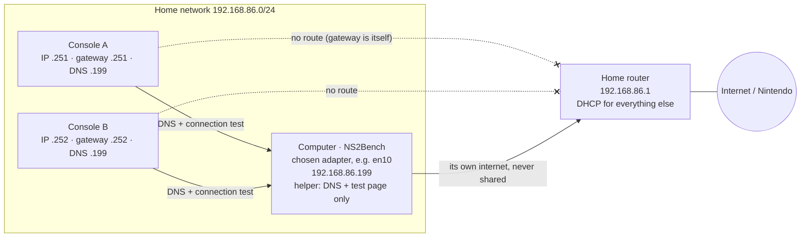
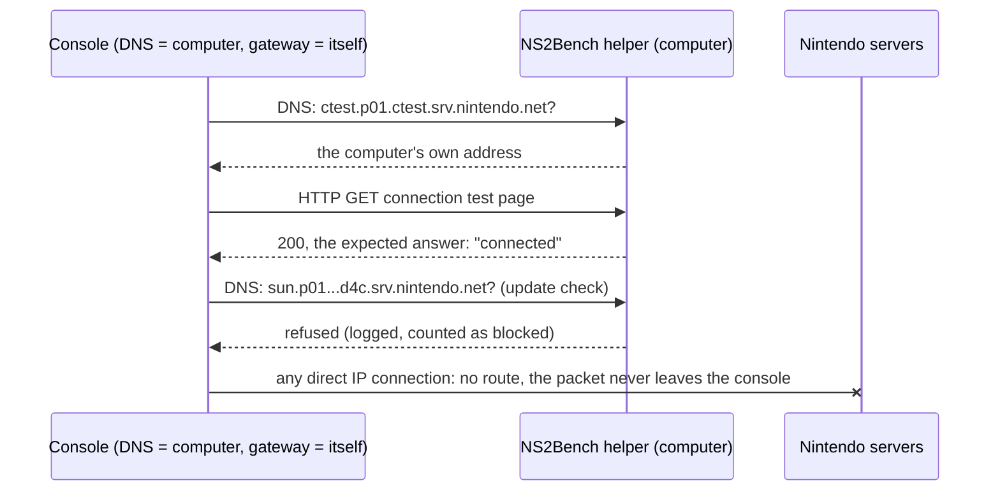

# Design: offline console on a shared home network

Status: implemented in 0.0.16. Setup steps for users are in
[the setup guide](../setup/README.md#d--shared-home-network-wi-fi-no-extra-hardware).

## Goal

Let a console sit on the same home network as the computer (usually over Wi-Fi), stay
**connected** (its connection test passes) and still reach **nothing on the internet**:
no Nintendo servers, no system updates, no eShop, no account sign-in, no telemetry. The
computer running NS2Bench must be able to reach the console.

No extra hardware: no second adapter, travel router or VLAN.

## Why the existing modes don't cover it

| Mode | How the console is cut off | Needs |
|---|---|---|
| A · Direct cable | No router exists on that link. Nothing to escape through. | A spare Ethernet adapter |
| B · Isolated router / VLAN | The router blocks internet. | A router that can do this |
| C · Remote helper | As A, run on another Linux machine. | A Linux board or PC |
| **D · Shared home network** (new) | The console's own manual settings point nowhere, and NS2Bench watches for that changing. | Nothing extra |

A home network has a working router, so a console that uses automatic settings is online at
once. The helper used to refuse to run DNS or the test page on such a network, for that
reason. Mode D lifts that refusal only under the conditions below.

## Threat model: every way a console could get out

| # | Path out | Blocked by | Verified by NS2Bench? |
|---|---|---|---|
| 1 | Looks up a Nintendo name (eShop, update, accounts, telemetry) | The helper's DNS refuses every name except the connection test | Yes: each lookup is logged with its result |
| 2 | Connects to a server by IP address (no lookup) | Gateway = the console's own IP: nothing off the home subnet has a route | No: lives in the console's settings. Covered by #5 |
| 3 | IPv6 route from the router | Router without IPv6, or IPv6 turned off | Setup checklist (asks the person to confirm) |
| 4 | The computer forwards traffic for it | The console never uses the computer as a gateway, and the helper stops serving if forwarding or internet sharing is on | Yes: continuously |
| 5 | Settings go back to automatic (reset, update, someone changes them): router DHCP gives a real gateway and DNS | **Leak watch** (see below) plus the router-side pause as a second lock | Detected within about a minute; the router pause is the person's to set |
| 6 | Another device on the LAN answers at the console's gateway address and forwards | Gateway = the console's own IP: no other device can ever hold it | Yes: the setup refuses any other gateway |
| 7 | A different, newer console passes a system update over local wireless | Not a network path. Documented: don't play local wireless with a newer console | No |
| 8 | The console joins another saved Wi-Fi network | Delete other saved networks on the console | Setup checklist |

"Blocks the internet totally" holds for 1, 2, 4 and 6 by design, and for 3 and 8 once the
checklist is done. Path 5 is the one weakness of any shared network: the console's settings
are the lock. Mode D cannot make that impossible, so it **detects it** and asks for a
router-side block as well. When "impossible even after a reset" is required, use mode A.

## Architecture

## The connection test, step by step

## Components

### 1. Helper (`ns2bench-netd`): topology `shared`

- New topology value `shared` next to `direct`, `router` and `none`.
- **DHCP can never run** in `shared`: the controls are rejected with `dhcp: true`, and the
  service ignores DHCP even if a file says otherwise. The DHCP pool becomes optional in the
  config and is not needed here.
- **Only listed consoles are answered.** `network.consoles` lists their addresses. DNS and the
  test page answer those addresses only; anything else on the home network is ignored. With
  no consoles listed, `shared` serves no one (fails closed).
- **DNS policy (unchanged, now spelled out):** the two connection-test names get the
  computer's address. Every other name, Nintendo or not, is refused (NXDOMAIN), and logged
  with `"local": false`. There is no upstream resolver to leak to.
- **Forwarding guard (unchanged):** with IP forwarding or internet sharing on, or unknown,
  nothing is served.
- **Per-console record:** the time of each console's last lookup and last connection test,
  and how many names were refused, are written to the status file for the leak watch.

### 2. Engine: setup, status, leak watch

- `GET /api/network/interfaces`: the computer's IPv4 adapters (name, friendly name, address,
  subnet), so the person **picks the adapter** instead of typing one.
- `POST /api/network/shared`: page only (UI key), not agents. Takes the adapter and the
  console addresses. It checks that the adapter exists and has that address, that each console
  is in the adapter's subnet and isn't the computer, and that IP forwarding is off. It backs up
  `~/.ns2bench/config.json`, writes the network section, sets the controls to `shared` (DNS
  and test page on, DHCP off) and returns the exact settings to type on each console.
- **Leak watch** (every 30 s while `shared` is active), for each listed console:
  - *protected*: asked NS2Bench in the last 10 minutes.
  - *on the network but not asking NS2Bench*: the computer can see it (ARP), but it hasn't used
    NS2Bench's DNS in 10 minutes. It may be on automatic settings and online. This is a warning
    in the Network tab, the log and a desktop notification.
  - *not seen*: off or away. Nothing to say.

  A console with manual settings looks up names all the time (update checks, eShop, news),
  so a long silence while it's switched on is a strong sign.

### 3. Interface: guided setup

Settings → Network → **Set up a shared home network**:

1. **Pick the adapter:** a list of the computer's adapters with their addresses (for example
   `en10 · Belkin USB-C LAN · 192.168.86.199/24`).
2. **Add the consoles:** their IP addresses on that network (reserve them in the router).
3. **Checklist:** router has no IPv6, or it's off · the computer's address is reserved in the
   router · other saved Wi-Fi networks deleted on each console.
4. **Save:** writes the setup and shows, per console, the four values to type
   (IP, subnet mask, gateway = its own IP, DNS = the computer).
5. **Restart the helper** (one button) so it binds to the chosen adapter.
6. **Live check:** each console's state (protected, warning, not seen), its last connection
   test and its refused lookups.

### 4. Docs

- Setup guide section **D · Shared home network** with a diagram, the steps, what is and isn't
  guaranteed, the router-side pause and how to read the leak watch.
- This design document.

## Failure behaviour

| What happens | Result | Console online? |
|---|---|---|
| The helper stops, or the computer is off | Lookups and the test fail, so the console says it can't connect | No |
| The computer's address changes | The console's DNS points nowhere, so the same as above | No |
| Forwarding or internet sharing turned on | The helper stops serving | No (the console doesn't route through the computer anyway) |
| The console's settings go back to automatic | It gets the router's gateway and DNS | **Yes.** The leak watch warns. A router-side pause would still block it |
| Two helpers on one computer | Both want DNS and the test page; the second can't start | No |

Every failure except the reset ends with the console offline. The reset is why the leak watch
and the router-side pause exist.

## Not doing

- **Being the console's gateway, as a sinkhole.** It would see escape attempts, but it would
  turn into a real route the moment internet sharing is switched on. "Gateway = itself" can't
  turn into a route.
- **Blocking at the router through its API.** Home routers (Google/Nest included) have no local
  API for this. The guide shows the router app's pause as a manual second lock.
- **Watching the console's traffic.** That needs packet capture as root, for little gain over
  the leak watch.
