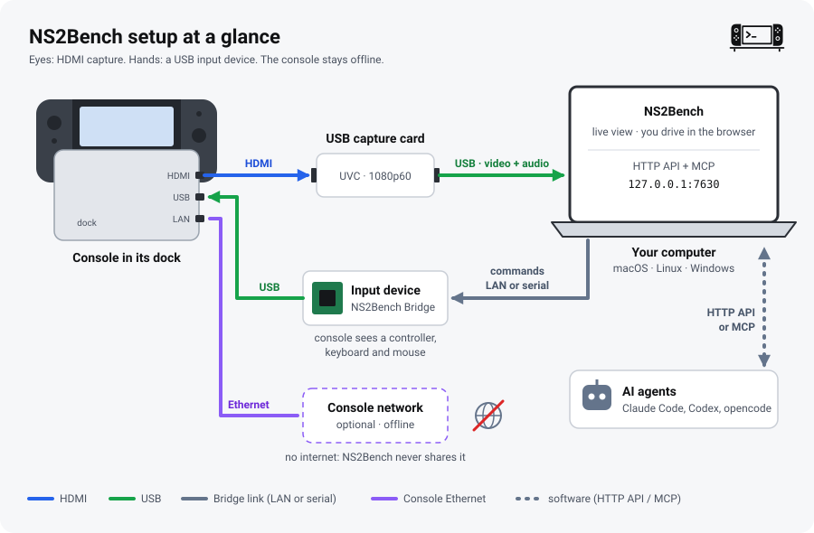
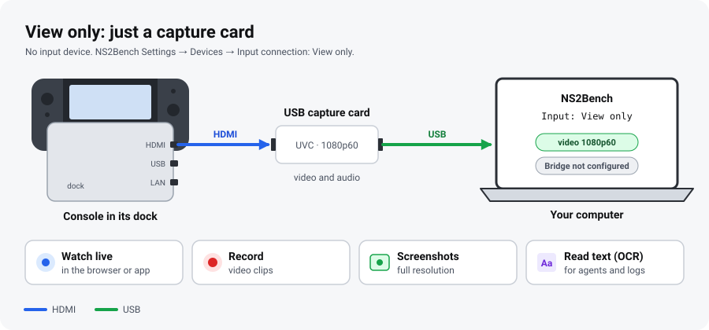
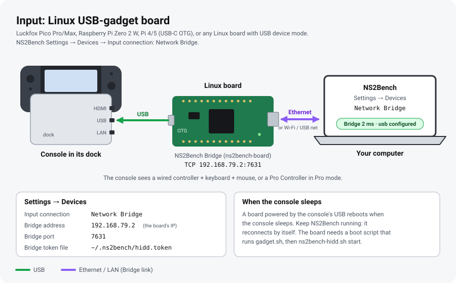
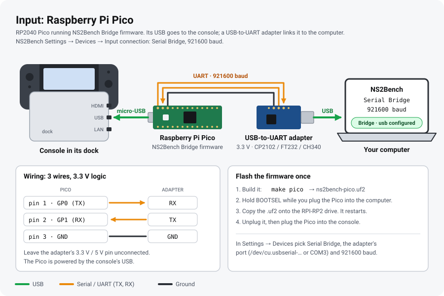
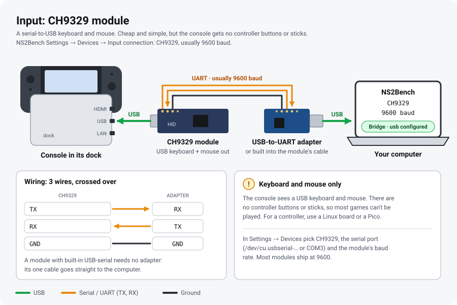
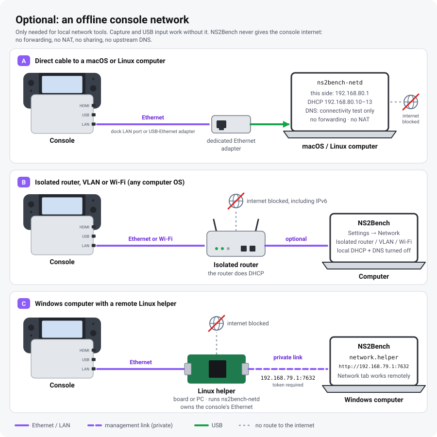

# Setting up NS2Bench

NS2Bench lets you, or an AI agent, see, hear and drive a Nintendo Switch 2 from a computer.
This guide shows how to wire it up.



Every setup has two independent parts:

- **Eyes (always):** the console's HDMI goes into a USB capture card. The card gives the computer video and audio.
- **Hands (optional):** a small input device plugs into the console's USB port. The computer sends it commands. The console sees a wired controller, keyboard and mouse.

People use the NS2Bench page in a browser or the desktop app. Agents use the HTTP API or MCP on the same computer (`127.0.0.1:7630`). Everyone shares one bench, and you see every agent action live.

**The console stays offline.** NS2Bench never gives it internet access. Capture and USB input need no network at all.

## Which setup do I need?

| What you have | Setup | Input connection in Settings |
|---|---|---|
| Only a capture card | [View only](#view-only) | View only |
| A Linux board with USB device mode (Luckfox Pico Pro/Max, Raspberry Pi Zero 2 W, Pi 4/5) | [Linux board](#linux-usb-gadget-board) | Network Bridge |
| A Raspberry Pi Pico (RP2040) and a 3.3 V USB-to-UART adapter | [Pico](#raspberry-pi-pico) | Serial Bridge |
| A CH9329 module (keyboard and mouse only) | [CH9329](#ch9329-module) | CH9329 |
| You also want the console on a local network (homebrew tools) | [Offline network](#optional-offline-console-network) | (Network tab) |

Not sure? Start with **view only**, then add an input device later. Input settings change without restarting the app.

If you want every controller button, including C, GL and GR, use a Linux board. Its **Pro** mode shows the console a Switch 2 Pro Controller. The Pico and the board's standard mode cover all buttons except C, GL and GR. CH9329 has no controller at all.

## Before you start: your computer

Install the app from the [latest release](https://github.com/phantomptr/ns2bench/releases/latest), then:

### macOS (14 or newer)

- **Nothing else to install.** Capture, sound and on-screen text reading are built into the app.
- First launch: if macOS says the app is damaged or can't be checked, run `xattr -dr com.apple.quarantine /Applications/NS2Bench.app` once.
- Allow **Camera** (the picture), **Microphone** (console sound) and **Local Network** (the input device) when asked. Change them later in System Settings → Privacy & Security.
- **Clips** (Save clip) need ffmpeg: `brew install ffmpeg`.
- Serial adapters (Pico, CH9329) work without drivers; they show up as `/dev/cu.usbserial-…` or `/dev/cu.usbmodem…`.

### Windows 10/11

- **Install ffmpeg** (capture, sound and clips use it): `winget install Gyan.FFmpeg`, then restart NS2Bench. NS2Bench also finds ffmpeg installed with Chocolatey or Scoop, or an `ffmpeg.exe` next to `ns2bench-app.exe`.
- SmartScreen may say "Windows protected your PC": choose **More info → Run anyway**.
- USB-to-UART adapters may need their vendor driver (CH340/CH341 or CP210x). The port shows up as `COM3` or similar in Device Manager.
- Optional: [Tesseract](https://github.com/UB-Mannheim/tesseract/wiki) for on-screen text reading.
- The offline console network service doesn't run on Windows: use a [Linux helper or a router](#optional-offline-console-network).

### Linux

- **ffmpeg:** the `.deb` installs it for you. With the AppImage, install it yourself (`sudo apt install ffmpeg`, `sudo dnf install ffmpeg`, `sudo pacman -S ffmpeg`).
- **Permissions:** add yourself to the groups that own capture cards and serial ports, then log out and in:
  `sudo usermod -aG video,dialout $USER` (Arch: `video,uucp`).
- AppImage: `chmod +x NS2Bench-*.AppImage`. If it won't start, install FUSE 2 (`sudo apt install libfuse2`).
- Optional: `sudo apt install tesseract-ocr` for on-screen text reading.
- Serial ports show up as `/dev/ttyACM0` (Pico) or `/dev/ttyUSB0` (most adapters).

## The capture card (every setup)

- Any USB **UVC** HDMI capture card works. 1080p60 is the goal. Tested: UGREEN 15389 (MS2130).
- Plug the console dock's **HDMI out** into the card's HDMI in. Plug the card into the computer by USB.
- Pick the card, resolution, frame rate and quality in the **Video** panel. It lists only what your card offers.
- **Audio** comes from the capture card too. There is no separate audio cable.
- **macOS:** a small built-in helper does the capture. It shares the card with OBS: if OBS already owns the card, NS2Bench uses OBS's format and never takes the card away. On first launch, allow **Camera** (picture), **Microphone** (console audio) and **Local Network** (the Bridge).
- **Linux and Windows:** NS2Bench uses `ffmpeg` (install it first). The card may need to be free, so close OBS or other apps that hold it if the picture does not start.
- Run `ns2bench devices` to list the capture cards NS2Bench can see.

## View only



The simplest bench. You can watch live, record, take full-resolution screenshots and read on-screen text (OCR). Agents can watch too, but nobody can press buttons.

**Parts**

- Console in its dock
- USB HDMI capture card (UVC)
- HDMI cable and the card's USB cable

**Steps**

1. Connect the dock's HDMI out to the capture card.
2. Plug the capture card into the computer.
3. Start NS2Bench and open `http://127.0.0.1:7630` (or the desktop app).
4. Pick your card in the **Video** panel.
5. In **Settings → Devices**, set **Input connection** to **View only** and click **Apply input connection**.

**Check it works**

- The **video** pill in the top bar turns green and the console picture appears.
- The **Bridge** pill says *not configured*. That is expected here.

**Common problems**

- *Black picture:* wake the console; make sure it is docked and the dock has power. Try another HDMI cable.
- *Card missing from the list:* on macOS, allow Camera access. On Linux or Windows, close any app that is using the card.
- *No sound:* on macOS, allow Microphone access. Check that the card is the selected audio source.

## Linux USB-gadget board



A small Linux board pretends to be USB devices. It runs **NS2Bench Bridge** (`ns2bench-board`). This is the tested setup (Luckfox Pico Pro/Max). It supports both controller modes:

- **Standard** (default): the console sees a HORI-style wired controller + USB keyboard + USB mouse.
- **Pro**: the console sees a Switch 2 Pro Controller, with every button including C, GL and GR. No keyboard or mouse in this mode.

Switch modes with **The console sees** in the Driving panel. It takes about 8 seconds.

**Parts**

- A Linux board with USB device (OTG) mode: Luckfox Pico Pro/Max, Raspberry Pi Zero 2 W, or Pi 4/5 using the USB-C port
- A USB cable from the board's **OTG** port to the dock's USB port
- An Ethernet cable to the computer (or use Wi-Fi or the board's USB network)
- The capture card setup above

**Steps**

1. Install NS2Bench Bridge on the board from the computer: `make board-install BOARD=<ssh-host>`. For a 64-bit Raspberry Pi add `BOARD_TARGET=aarch64-unknown-linux-musl`.
2. Plug the board's **OTG** USB port into the dock's USB port.
3. Connect the board's Ethernet to the computer (or join both to the same private network).
4. Start the Bridge if it is not already running: `ssh <ssh-host> /opt/ns2bench/ns2bench-hidd.sh start --bind <board-ip>`.
5. Make sure the token file `~/.ns2bench/hidd.token` on the computer matches the board's token.
6. In **Settings → Devices** set:
   - **Input connection:** Network Bridge
   - **Bridge address:** the board's IP (default `192.168.79.2`)
   - **Bridge port:** `7631`
   - **Bridge token file:** `~/.ns2bench/hidd.token`
7. Click **Apply input connection**.

**Check it works**

- The **Bridge** pill turns green and shows the round-trip time and *usb configured*.
- Press a button on the on-screen Joy-Con. The console reacts, and the button lights up.

**When the console sleeps**

A board powered by the console's USB loses power when the console sleeps, and boots again when it wakes. Keep NS2Bench running: it notices within about three seconds and reconnects by itself. Input works again once the board has booted and the console has set up its USB.

For this to work, the board must bring itself back up at boot. Add a boot script for your board that runs `/opt/ns2bench/gadget.sh` and then `/opt/ns2bench/ns2bench-hidd.sh start`. Test one real sleep and wake for your board and dock.

**Common problems**

- *Bridge offline · reconnecting:* check the cable and the board's IP. Ping the board. Make sure the Bridge is running on it.
- *Bridge connected but usb is not configured:* wake the console. Check that the cable goes to the board's **OTG** port, not a power-only port. Some cables carry power only.
- *Mouse does nothing on the HOME menu:* normal. The console reads the mouse, but only some software shows a cursor.
- *Keyboard ignored:* the console's USB keyboard support is under System Settings → Controllers & Accessories.
- On the board, stop and start things with `ns2bench-hidd.sh` and `gadget.sh` only. Do not kill processes by pattern.

## Raspberry Pi Pico



A Raspberry Pi Pico (RP2040) running NS2Bench Bridge firmware. Its USB port goes to the console and shows the same controller + keyboard + mouse as a Linux board in standard mode. The computer talks to it over a serial (UART) link through a separate USB-to-UART adapter.

> The Pico firmware is built but has not been run on real hardware yet. Reports are welcome.

**Parts**

- Raspberry Pi Pico (RP2040) and a micro-USB cable
- A **3.3 V** USB-to-UART adapter (CP2102, FT232 or CH340)
- Three jumper wires
- The capture card setup above

**Steps**

1. Build the firmware: `make pico`. You get `firmware/pico/ns2bench-pico.uf2`.
2. Hold the **BOOTSEL** button while you plug the Pico into the **computer**. A drive called **RPI-RP2** appears.
3. Copy the `.uf2` file onto that drive. The Pico restarts. Unplug it.
4. Wire the Pico to the adapter:
   - Pico **GP0** (pin 1, UART0 TX) → adapter **RX**
   - Pico **GP1** (pin 2, UART0 RX) ← adapter **TX**
   - Pico **GND** (pin 3) — adapter **GND**
   - Leave the adapter's 3.3 V / 5 V pin unconnected. The Pico gets power from the console.
5. Plug the Pico's micro-USB into the dock's USB port.
6. Plug the adapter into the computer.
7. In **Settings → Devices** set:
   - **Input connection:** Serial Bridge
   - **Serial port:** the adapter (for example `/dev/cu.usbserial-XXXX` on macOS, `/dev/ttyUSB0` on Linux, `COM3` on Windows)
   - **Baud rate:** `921600`
8. Click **Apply input connection**.

Optional: build with `NS2BENCH_TOKEN=... make pico` to make the Pico require a token (set the same token file on the computer). Build with `NS2BENCH_BAUD=115200` if your adapter cannot do 921600.

**Check it works**

- The **Bridge** pill turns green and shows *usb configured*.
- An on-screen Joy-Con press reaches the console.

**Common problems**

- *No serial port shows up:* install the adapter's driver (CP210x, FTDI or CH340), then replug it.
- *Bridge offline:* TX and RX are probably swapped. TX always goes to RX. Also check GND.
- *Garbled or no replies:* the baud rate must match the firmware (921600 unless you built it with another value).
- *Never use a 5 V adapter.* The Pico's pins are 3.3 V only.

## CH9329 module



A CH9329 module turns serial commands into a USB keyboard and mouse. It is cheap and simple, but it **has no controller**: no buttons, no sticks. Use it for typing and pointing only.

**Parts**

- A CH9329 module
- A 3.3 V USB-to-UART adapter, unless your module's cable has USB-serial built in
- The capture card setup above

**Steps**

1. Plug the module's USB (HID) side into the dock's USB port.
2. Wire the UART side to the adapter: module TX → adapter RX, module RX ← adapter TX, GND — GND. (Skip this if the module has built-in USB-serial.)
3. Plug the adapter (or the module's serial cable) into the computer.
4. In **Settings → Devices** set:
   - **Input connection:** CH9329
   - **Serial port:** the adapter's port
   - **Baud rate:** the module's setting, usually `9600`
5. Click **Apply input connection**.

**Check it works**

- The **Bridge** pill turns green.
- Typing in the native keyboard mode shows up on the console (for example in a text field).

**Common problems**

- *Controller buttons do nothing:* expected. CH9329 is keyboard and mouse only.
- *Nothing happens:* check the baud rate and swap TX/RX if needed.
- *Keyboard ignored by the console:* check System Settings → Controllers & Accessories → USB Keyboard.

## Optional: offline console network



You only need this for local network tools, such as homebrew loaders. Capture and input never need it.

Whichever variant you pick, the console gets **no internet**. NS2Bench never forwards traffic, never turns on internet sharing, NAT or a proxy, and never asks an outside DNS server. Its local DNS answers only the console's connectivity test; every other name is refused. Every lookup the console tries shows up in the **network** log.

The Bridge link from the computer to a Linux board is separate. It can use your normal LAN.

### A · Direct cable (macOS or Linux)

**Parts:** a spare Ethernet adapter on the computer just for the console, an Ethernet cable, and the dock's LAN port (or a USB-Ethernet adapter on the console).

1. Give the dedicated adapter a fixed private address, for example `192.168.80.1/24`. NS2Bench does not configure the interface for you.
2. Describe that interface in `bench.json` (use your adapter's interface name):
   ```json
   "network": { "interface": "en7", "address": "192.168.80.1", "subnet": "192.168.80.0/24",
                "pool_start": "192.168.80.10", "pool_end": "192.168.80.13" }
   ```
   Build the network service: `make netd`.
3. Check the config without opening any ports: `native/target/release/ns2bench-netd --check bench.json`.
4. Install it as a service:
   - **macOS:** copy the binary to `~/.ns2bench/bin/ns2bench-netd`, fill in `launchd/ns2bench-netd.plist.template` and copy it to `~/Library/LaunchAgents/`. No root needed.
   - **Linux:** install it at `/opt/ns2bench/ns2bench-netd` and use the systemd unit `launchd/ns2bench-netd.service`.
5. Connect the console's Ethernet to the dedicated adapter.
6. In **Settings → Network**, choose **Direct, isolated computer ↔ console**. Turn on local DHCP, DNS and the connectivity-test page as needed, then apply.

The console gets an address from the pool (for example `192.168.80.10`–`192.168.80.13`). The **Network** tab shows the live status and leases.

The service refuses to start if IP forwarding is on, or if it cannot check. That is on purpose.

### B · Isolated router, VLAN or Wi-Fi (any OS)

1. Set up a router, VLAN or Wi-Fi network for the console with **internet blocked, including IPv6**. A normal home LAN is not isolated.
2. Let the router hand out addresses (DHCP).
3. Connect the console to it by Ethernet or Wi-Fi.
4. In **Settings → Network**, choose **Isolated router / VLAN / Wi-Fi**. This turns off NS2Bench's local DHCP and DNS so they don't clash with the router.

### C · Windows computer with a remote helper

Windows cannot run the network service locally. Run it on a Linux board or PC instead, and control it from Windows.

1. On the Linux helper, set up `ns2bench-netd` as in variant A. The helper owns the console's Ethernet.
2. Make a token: `openssl rand -hex 16 > ~/.ns2bench/netd-control.token`. Copy the same file to the Windows computer.
3. In the helper's config, add a management listener on a private address that is **not** on the console network:
   ```json
   "network": { "control": { "listen": "192.168.79.1:7632", "token_file": "~/.ns2bench/netd-control.token" } }
   ```
4. In NS2Bench's config on Windows, point to the helper:
   ```json
   "network": { "helper": { "url": "http://192.168.79.1:7632", "token_file": "~/.ns2bench/netd-control.token" } }
   ```
5. Keep the management link private: a direct cable or the board's USB network. Its traffic is plain HTTP.

The **Network** tab on Windows then shows the helper's status and controls. Or skip the helper and use variant B.

**Common problems**

- *Network tab says unavailable:* the service is not running, or it and the UI use different state folders. On Windows, check `network.helper` and that both token files match.
- *Console gets no address:* check the interface name and subnet in the config, and that the cable goes to the dedicated adapter.
- *Console says it has no internet:* that is correct. The connectivity test passes locally, but nothing goes further.

## Agents

Once the pills are green, agents can use the bench. Open **Settings → API & MCP** for the API address, request examples and a ready-to-copy MCP configuration for Claude Code, Codex or opencode. Agents and people share the same controls, and the manual-only switch blocks agent input at any time.

## Windows notes

- Capture uses `ffmpeg` with DirectShow. Close other apps that hold the card.
- The Linux board, Pico and CH9329 all work from Windows. Serial ports are named `COM3`, `COM4` and so on.
- There is no local network service on Windows. Use a remote helper (variant C) or an isolated router (variant B).
